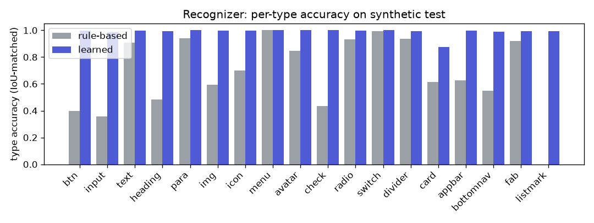

# Results

Generated by `python -m s2a.results` from `docs/results/*.json`; every number comes from a script run.
Rows marked **pending** have not been run yet. Synthetic test = 1,000 sketches from apps never seen in training (split by app); real test = held-out participants from Collect mode.

## 1. Stroke recognizer

Detection: a predicted element matches a gold element at IoU >= 0.5. *Any-type F1* ignores the type;
*typed* requires the type too. Stroke accuracy = frame/text/shape/arrow per stroke.

### Synthetic test (1,000 sketches)

| Method | Any-type F1 | Typed P | Typed R | Typed F1 | Stroke acc. | Laptop ms/sketch |
|---|---:|---:|---:|---:|---:|---:|
| Rule-based (baseline) | 0.663 | 0.424 | 0.572 | **0.487** | 0.850 | 2.5 |
| Learned (ONNX, ships in app) | 0.983 | 0.986 | 0.974 | **0.980** | 1.000 | 48.7 |
| Learned + real-data fine-tune | pending | | | | | |

### Real sketches (held-out participants)

| Method | Any-type F1 | Typed P | Typed R | Typed F1 | Stroke acc. | Laptop ms/sketch |
|---|---:|---:|---:|---:|---:|---:|
| Rule-based (baseline) | pending | | | | | |
| Learned (ONNX, ships in app) | pending | | | | | |
| Learned + real-data fine-tune | pending | | | | | |

Export and parity: ONNX 8.05 MB; PyTorch vs ONNX Runtime 1.28.0 max |diff| 9.9e-05; laptop CPU 14.2 ms/sketch (Dart feature/decoder parity: app/test/recognizer_parity_test.dart).

## 2. Layout (element list -> UI spec)

Tree similarity = 1 - TED / max(|T|) (APTED, structure only); type F1 over leaf element types; link F1
only over samples whose gold spec has navigation links.

### Input: gold element lists (layout stage in isolation)

| Method | Samples | JSON valid | Schema valid | Tree sim. | Type F1 | Link F1 | Labels | ms/sample |
|---|---:|---:|---:|---:|---:|---:|---:|---:|
| Rule-based builder (baseline) | 1000 | 1.000 | 1.000 | **0.816** | 0.873 | 0.934 | 0.995 | 0.4 |
| Gemma 4 E2B base, 3-shot | pending | | | | | | | |
| Gemma 4 E2B + LoRA | pending | | | | | | | |
| Qwen3.5-0.8B + LoRA | pending | | | | | | | |

### Input: trained recognizer output (realistic errors)

| Method | Samples | JSON valid | Schema valid | Tree sim. | Type F1 | Link F1 | Labels | ms/sample |
|---|---:|---:|---:|---:|---:|---:|---:|---:|
| Rule-based builder (baseline) | 1000 | 1.000 | 1.000 | **0.801** | 0.865 | 0.687 | 0.973 | 0.3 |
| Gemma 4 E2B base, 3-shot | pending | | | | | | | |
| Gemma 4 E2B + LoRA | pending | | | | | | | |
| Qwen3.5-0.8B + LoRA | pending | | | | | | | |

### Input: trained recognizer output on real sketches (held-out participants)

| Method | Samples | JSON valid | Schema valid | Tree sim. | Type F1 | Link F1 | Labels | ms/sample |
|---|---:|---:|---:|---:|---:|---:|---:|---:|
| Rule-based builder (baseline) | pending | | | | | | | |
| Gemma 4 E2B base, 3-shot | pending | | | | | | | |
| Gemma 4 E2B + LoRA | pending | | | | | | | |
| Qwen3.5-0.8B + LoRA | pending | | | | | | | |

## 3. Spec format and export

- Spec size on the 11 hand-written examples: median 122 Gemma 4 tokens per screen (max 181); pretty-printed JSON costs 2.5x more.
- **Ablation, spec vs direct Dart:** the generated Dart for the same apps (screens + main.dart) costs **3.9x** the tokens of the canonical spec (output tokens set decode time). Latency of direct-Dart generation: pending (needs the trained LLM).
- Exported projects passing `flutter analyze` (stricter lints): 11/11, generated tests passing 11/11 (Flutter 3.44.0).
- RICO-derived specs: see docs/data_report.md (median tokens per real screen).

## 4. End-to-end and on-device

Synthetic test sketches through the whole pipeline on the laptop (`python -m s2a.e2e`): ink -> learned
recognizer (ONNX) -> layout -> spec -> preview render (phone size, overflow counts as failure) -> export
-> `flutter analyze` on the first 20 exported projects. Handwriting is an oracle here (gold labels on
matched elements): ML Kit only runs on Android, so its accuracy and latency are measured on the device.

| Layout | Sketches | Spec valid | Rendered | Exports passing analyze | Recognizer ms | Layout ms |
|---|---:|---:|---:|---:|---:|---:|
| Rule-based builder (baseline) | 200 | 1.000 | **1.000** | 20/20 | 48.7 | 0.5 |
| Rule-based builder, on the LLM rows' samples | pending | | | | | |
| Gemma 4 E2B base, 3-shot | pending | | | | | |
| Gemma 4 E2B + LoRA | pending | | | | | |
| Qwen3.5-0.8B + LoRA | pending | | | | | |

| Measure | Value |
|---|---|
| Latency per stage on the Android device(s) | pending (needs device) |
| Peak memory on device | pending (needs device) |
| Render success rate on real sketches | pending (needs Collect data) |
| Layout model size (.litertlm / GGUF) | pending (needs notebook run) |

## 5. Photo mode (paper sketches)

Photos are turned into strokes by the app's vectorizer, then recognized like drawn ink. Synthetic
photos: 1,000 test-split sketches (apps never seen in training) rendered as phone photos of paper.

### Recognizer on synthetic photos

| Method | Any-type F1 | Typed P | Typed R | Typed F1 | Stroke acc. | Laptop ms/sketch |
|---|---:|---:|---:|---:|---:|---:|
| Rule-based (baseline) | 0.329 | 0.152 | 0.218 | **0.179** | 0.533 | 2.7 |
| Ink model, zero-shot | 0.477 | 0.342 | 0.285 | **0.311** | 0.774 | 52.0 |
| Photo model (ink model fine-tuned on photos) | 0.774 | 0.820 | 0.693 | **0.751** | 0.970 | 51.1 |

### End to end on synthetic photos (rule-based layout, oracle labels)

| Sketches | Spec valid | Rendered | Exports passing analyze | Vectorize ms | Recognizer ms | Layout ms |
|---:|---:|---:|---:|---:|---:|---:|
| 200 | 1.000 | **1.000** | 20/20 | 105 | 51.1 | 3.2 |

### Specs from synthetic photos (rule-based layout, oracle labels)

| Input to the layout stage | Tree sim. | Type F1 | Link F1 | Screens correct |
|---|---:|---:|---:|---:|
| Perfect elements (layout stage alone) | **0.782** | 0.872 | 0.920 | 1.000 |
| Photo model output | **0.674** | 0.792 | 0.153 | 0.926 |

### Real paper sketches (Photo study: target app drawn on paper, scored against its spec)

| Run | Photos (people) | Tree sim. | Type F1 | Link F1 | Screens | Labels |
|---|---:|---:|---:|---:|---:|---:|
| On the device (photo model + OCR) | pending (needs the Photo study) | | | | | |
| Laptop re-run (photo model, no OCR) | pending (needs the Photo study) | | | | | |

Device latency per stage (median ms): pending (needs the Photo study).

## 6. Ablations

| Ablation | Status |
|---|---|
| Noise augmentation on/off (layout model) | pending |
| Recognizer with/without real-data fine-tuning | pending (needs Collect data) |
| Spec vs direct Dart (tokens) | see section 3 |
